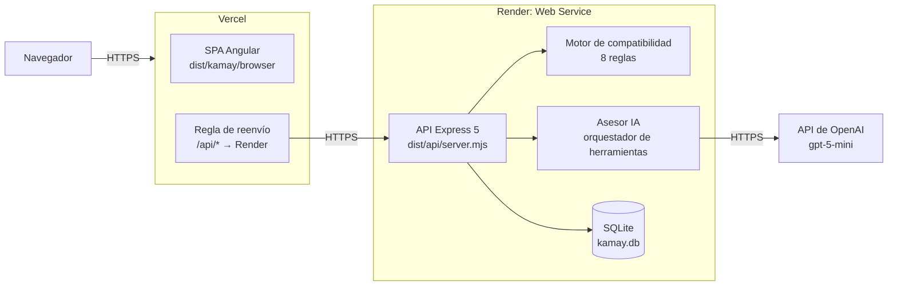

# Plan de despliegue

Este documento describe cómo se publicará Kamay en internet. Es un **plan**: todavía no hay nada desplegado, y los cambios de código de la sección 4 aún no están hechos.

Criterio general: desplegar el sistema **tal como está** (Angular + Express + SQLite) en servicios gratuitos y con los menores cambios posibles. No se migra la base de datos ni se agregan piezas que el MVP no usa.

## 1. Arquitectura y entornos

### 1.1 Arquitectura de despliegue



- **Vercel** sirve los archivos estáticos de Angular (HTML, JS, CSS) desde su CDN.
- Angular llama siempre a rutas relativas (`/api/...`). Vercel **reenvía** esas peticiones a Render. Así el navegador habla con un único dominio y no hace falta configurar CORS ni cambiar el frontend.
- **Render** ejecuta la API en Node. La base de datos es un archivo SQLite dentro del mismo servicio: no hay un servidor de base de datos aparte.
- Solo la API conoce la clave de OpenAI. El navegador nunca la ve.

### 1.2 Entornos

| Entorno | Frontend | API | Base de datos | Cuándo se actualiza |
| --- | --- | --- | --- | --- |
| Desarrollo | `ng serve` en `localhost:4200` (el proxy reenvía `/api`) | `npm run api:start` en `127.0.0.1:3000` | `data/kamay.db` local | Al guardar cambios |
| Vista previa | URL temporal de Vercel por cada rama o PR | La API de producción | La de producción | Con cada push a una rama que no sea `master` |
| Producción | `https://<proyecto>.vercel.app` | `https://<servicio>.onrender.com` | SQLite en Render | Con cada push a `master` que pase la CI |

No se crea un entorno de *staging* aparte: para un equipo de tres personas y un MVP académico, duplicaría el costo y el mantenimiento. Los riesgos se cubren con los tests de la CI y con las vistas previas de Vercel. Las vistas previas usan la API de producción, así que los pedidos de prueba que se hagan ahí quedan registrados en producción.

Las URLs definitivas dependen de los nombres que estén libres al crear los proyectos.

## 2. Requisitos previos

| Requisito | Versión | Para qué |
| --- | --- | --- |
| Node.js | **22.13 o superior** (recomendado: 24 LTS) | `node:sqlite` no existe en versiones anteriores |
| npm | El que trae Node | Instalar dependencias (`npm ci`) |
| Git y cuenta de GitHub | — | Repositorio `BenjaIDLC/kamay`, del que despliegan Vercel y Render |
| Cuenta en Vercel | Plan Hobby (gratis) | Frontend |
| Cuenta en Render | Plan Free (o Starter, ver 3.3) | API y base de datos |
| Cuenta en OpenAI | Con créditos | Asesor IA |

Las versiones del stack salen de `package.json`: Angular 22.2, Express 5.1 y TypeScript 6.0. No hacen falta PostgreSQL, Docker ni PM2.

## 3. Variables de entorno

### 3.1 Seguridad de las credenciales

- `.env` está en `.gitignore` y nunca se sube. `.env.example` documenta qué variables existen, sin valores secretos.
- En la nube, las variables se cargan en el panel de Render (*Environment*). El frontend no necesita ninguna.
- La clave de OpenAI debe pertenecer a un **proyecto propio de Kamay** en OpenAI, con un **límite de gasto mensual** (p. ej. 5 USD). Si se filtra o abusan del chat, la pérdida tiene un tope.

### 3.2 Variables que lee la API

Estas son **todas** las variables que usa el código (`backend/server.mts` y `backend/advisor.mts`):

| Variable | Obligatoria | Local | Render | Uso |
| --- | --- | --- | --- | --- |
| `OPENAI_API_KEY` | Para el chat | `sk-...` en `.env` | `sk-...` (secreto) | Autenticación con OpenAI. Sin ella, todo funciona salvo el asesor, que muestra un error recuperable |
| `ADVISOR_SECRET` | En la nube, sí | Sin definir (se genera una al arrancar) | Cadena aleatoria larga (secreto) | Firma las respuestas del asesor para detectar historiales falsificados. Si no se fija, cada reinicio genera otra clave y las conversaciones abiertas dejan de validarse; en el plan Free la API se reinicia con frecuencia |
| `OPENAI_MODEL` | No | `gpt-5-mini` | `gpt-5-mini` | Modelo del asesor |
| `PORT` | No | `3000` | La define Render | Puerto en el que escucha la API |
| `DB_FILE` | No | `data/kamay.db` | `data/kamay.db` o `/var/data/kamay.db` (ver 3.3) | Ruta del archivo SQLite |
| `ADVISOR_DEBUG` | No | `1` para depurar | Sin definir | Registra en consola las herramientas que llama el modelo |
| `NODE_VERSION` | No | — | `24` | Versión de Node que instala Render |

### 3.3 Persistencia de la base de datos

Al arrancar, la API crea el esquema y, si la base está vacía, carga el catálogo inicial. El catálogo siempre está disponible. Lo único que puede perderse son los **pedidos**.

- **Plan Free de Render (el que se usará):** el disco es efímero. Los pedidos se borran con cada despliegue o reinicio. Para la demo es aceptable porque el pago es simulado, pero hay que decirlo al presentar.
- **Plan Starter + disco persistente (de pago, unos 7 USD/mes):** se monta un disco en `/var/data` y se define `DB_FILE=/var/data/kamay.db`. Los pedidos sobreviven y Render guarda instantáneas diarias del disco.

No se migra a PostgreSQL ni a Supabase. El acceso a datos usa la API síncrona de `node:sqlite`, así que migrar implicaría reescribir los repositorios y el esquema. Es un cambio grande que no aporta nada al alcance del MVP.

## 4. Cambios necesarios antes de desplegar

| # | Cambio | Archivo | Motivo |
| --- | --- | --- | --- |
| 1 | Escuchar en `0.0.0.0` en vez de `127.0.0.1` | `backend/server.mts` (última línea) | Con `127.0.0.1`, Render no puede enrutar tráfico a la API y el despliegue falla |
| 2 | Agregar `"engines": { "node": ">=22.13" }` | `package.json` | Que Vercel y Render no usen una versión de Node sin `node:sqlite` |
| 3 | Crear `vercel.json` (sección 5.2) | Raíz del repo | Reenviar `/api` a Render y servir la SPA en rutas como `/configurador` |
| 4 | Crear `.github/workflows/ci.yml` (sección 6) | `.github/` | Ejecutar los tests en cada push |
| 5 | Limitar las peticiones a `/api/advice` (p. ej. 20 cada 10 min por IP) y llamar a `app.set('trust proxy', true)` | `backend/server.mts` | Cada mensaje del chat cuesta dinero; una URL pública sin límite se puede abusar |

Hay otro riesgo **conocido y aceptado**. Sin cuentas de usuario (fase B), `GET /api/orders` muestra todos los pedidos y `POST /api/orders/:id/advance` lo puede invocar cualquiera. En producción solo deben usarse datos de prueba, nunca datos reales de clientes.

## 5. Paso a paso

### 5.1 API en Render

1. En Render: **New → Web Service**, conectar el repo `BenjaIDLC/kamay` y elegir la rama `master`.
2. Configurar:
   - **Runtime:** Node
   - **Build Command:** `npm ci && npm run api:build`
   - **Start Command:** `node dist/api/server.mjs`
   - **Health Check Path:** `/api/catalog`
   - **Instance Type:** Free
3. En *Environment*, cargar `OPENAI_API_KEY`, `ADVISOR_SECRET` (generada con `openssl rand -hex 32`), `OPENAI_MODEL=gpt-5-mini` y `NODE_VERSION=24`.
4. En *Settings → Auto-Deploy*, elegir **After CI Checks Pass**: Render solo despliega si la CI de GitHub pasó.
5. Desplegar y anotar la URL (`https://<servicio>.onrender.com`).

La API lee `backend/schema.sql` del repositorio al arrancar. Por eso se ejecuta desde la carpeta del repo y no solo con `dist/`.

### 5.2 Frontend en Vercel

1. Crear `vercel.json` en la raíz, con la URL real de Render:

   ```json
   {
     "rewrites": [
       { "source": "/api/:path*", "destination": "https://<servicio>.onrender.com/api/:path*" },
       { "source": "/(.*)", "destination": "/index.html" }
     ]
   }
   ```

   Vercel sirve primero los archivos que existen (JS, CSS, imágenes). La segunda regla hace que una recarga en `/configurador` devuelva la SPA en vez de un 404.
2. En Vercel: **Add New → Project**, importar el repo y configurar:
   - **Framework Preset:** Angular
   - **Build Command:** `npm run build`
   - **Output Directory:** `dist/kamay/browser`
   - **Production Branch:** `master`
3. Desplegar. Vercel crea vistas previas para las demás ramas.

### 5.3 Ejecución local (referencia)

```bash
npm ci
cp .env.example .env    # completar OPENAI_API_KEY
npm run api:start       # terminal 1: API en http://127.0.0.1:3000
npm start               # terminal 2: app en http://localhost:4200
```

## 6. Integración y despliegue continuos

El flujo completo:

1. Se hace push a `master`.
2. GitHub Actions ejecuta la CI: instala, ejecuta los tests de la API y compila el frontend.
3. Si la CI pasa, Render despliega la API.
4. Vercel compila y publica el frontend por su cuenta. Si `npm run build` falla, Vercel no publica y la versión anterior sigue en línea.

No se usan *deploy hooks* ni secretos en GitHub: Vercel y Render ya están conectados al repositorio.

Fases de la CI:

| Fase | Comando | Qué comprueba |
| --- | --- | --- |
| Instalación | `npm ci` | Que `package-lock.json` sea instalable |
| Tipos y tests de la API | `npm run api:test` | Compila el backend con `tsc` (chequeo de tipos estricto) y ejecuta los 19 tests: motor, base de datos, API, pedidos y asesor con un proveedor simulado, sin gastar créditos |
| Build del frontend | `npm run build` | Compila Angular en modo producción, con chequeo de plantillas y límites de tamaño del bundle |

El proyecto no tiene linter configurado. El chequeo de tipos lo hacen `tsc` y el compilador de Angular. `npm run api:test:live` no va en la CI porque consume créditos de OpenAI.

`.github/workflows/ci.yml`:

```yaml
name: CI

on:
  push:
    branches: [master]
  pull_request:
    branches: [master]

jobs:
  test-and-build:
    runs-on: ubuntu-latest
    steps:
      - uses: actions/checkout@v4
      - uses: actions/setup-node@v4
        with:
          node-version: 24
          cache: npm
      - run: npm ci
      - run: npm run api:test
      - run: npm run build
```

## 7. Verificación, monitoreo y rollback

### 7.1 Prueba de humo

Después de cada despliegue a producción, ejecutar las peticiones contra la URL de **Vercel**. Así se prueba también la regla de reenvío.

```bash
curl -s https://<proyecto>.vercel.app/api/catalog | head -c 200
```

```bash
curl -s https://<proyecto>.vercel.app/api/builds | head -c 200
```

```bash
curl -s -X POST https://<proyecto>.vercel.app/api/configurations/validate -H "Content-Type: application/json" -d "{}"
```

| Verificación | Resultado esperado |
| --- | --- |
| `GET /api/catalog` | 200, JSON con `"currency":"PEN"` y la lista de componentes |
| `GET /api/builds` | 200, los 4 equipos base con `"status":"valida"` |
| `POST /api/configurations/validate` con `{}` | 200, `"status":"incompleta"` (el motor responde) |
| Abrir `/configurador` y recargar la página | Carga la SPA, no un 404 |
| Enviar "hola" en el Asesor IA | Responde en español y pregunta por el uso y el presupuesto (gasta una fracción de centavo) |

### 7.2 Monitoreo y logs

- **Render → Logs:** salida de la API en tiempo real. Ahí aparecen los errores 500 (`console.error`) y, con `ADVISOR_DEBUG=1`, las herramientas que llama el asesor.
- **Render → Events:** historial de despliegues y fallos del *health check*.
- **Vercel → Deployments:** log de compilación de cada despliegue. Las peticiones a `/api` reenviadas aparecen en **Logs**.
- **OpenAI → Usage:** gasto diario del proyecto, para detectar abusos del chat.

En el plan Free, Render apaga la API tras unos 15 minutos sin tráfico y la primera petición tarda entre 30 y 60 s. Antes de una presentación hay que abrir la página un par de minutos antes. Esta demora no cuenta en las mediciones del RNF-01, que se hicieron con la API activa.

### 7.3 Plan de retorno (rollback)

| Qué falla | Acción | Tiempo aproximado |
| --- | --- | --- |
| El frontend (pantalla rota, error de JS) | Vercel → Deployments → despliegue anterior → **Instant Rollback** | Menos de 1 min |
| La API (500, *health check* fallido) | Render → Events → despliegue anterior → **Rollback** | 2–3 min |
| Un commit defectuoso que hay que corregir en el código | `git revert <commit>` y `git push`: la CI y los despliegues automáticos publican la versión corregida | 5 min |
| La base de datos (solo con disco persistente) | Render → Disks → restaurar una instantánea | Depende del tamaño |

Después de un rollback hay que repetir la prueba de humo (7.1).

## 8. Alternativa: contenedor Docker (no planificada)

Si en el futuro se necesitara un servidor propio, la misma API puede empaquetarse en una imagen con Node 24. Habría que copiar el código compilado **y** `backend/schema.sql`, y montar un volumen para `DB_FILE`. No forma parte de este plan porque Vercel y Render ya cubren el despliegue sin mantener servidores.
