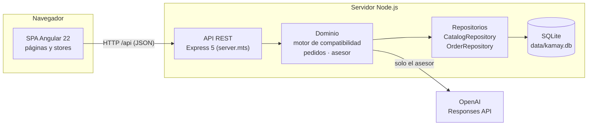
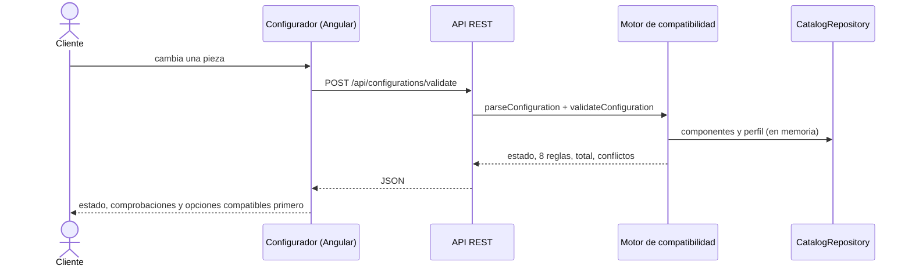
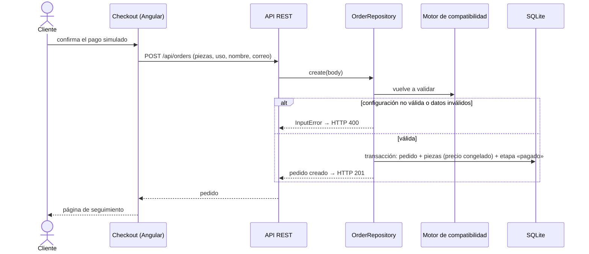
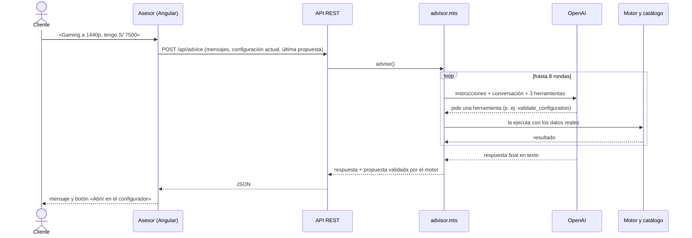
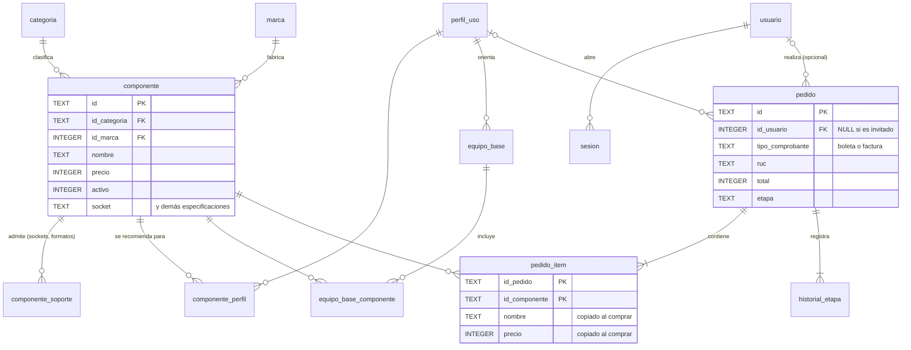

# 10. Construcción de la solución (Avance 3)

Este capítulo describe lo que está implementado en el repositorio a la semana 12: la arquitectura, el código, la persistencia, la seguridad, las pruebas, el avance y el control de versiones. Todo lo que se menciona aquí existe en el código; lo pendiente se indica de forma explícita.

Repositorio: https://github.com/BenjaIDLC/kamay (rama `master`).

## 10.1 Arquitectura general

Kamay es una aplicación web de dos partes escritas en TypeScript:

- **Frontend:** una SPA (aplicación de una sola página) en Angular 22 que corre en el navegador.
- **Backend:** una API REST en Node.js con Express 5, que concentra la lógica del negocio y el acceso a los datos.

El navegador nunca decide precios ni compatibilidad: cada cambio de configuración se valida en el servidor, y el servidor vuelve a validar al crear el pedido. El servicio de IA (OpenAI) solo lo usa el asesor, a través del backend.

En desarrollo, el servidor de Angular reenvía las peticiones `/api` a la API en el puerto 3000 (`proxy.conf.json`).

## 10.2 Organización del código

### Backend (`backend/`)

| Módulo | Responsabilidad |
|---|---|
| `server.mts` | Crea la aplicación Express: define las rutas `/api`, valida la entrada y traduce los errores a códigos HTTP (400, 404, 413, 500). |
| `compatibility.mts` | Motor de compatibilidad: 8 reglas, estado global, total, presupuesto y conflictos por producto. Valida toda entrada con `parseConfiguration`. |
| `advisor.mts` | Asesor IA: instrucciones del modelo, las 3 herramientas y el ciclo de llamadas (máximo 8 rondas, 90 s). |
| `orders.mts` | Pedidos: creación con revalidación y avance por etapas. Contiene `OrderRepository`. |
| `catalog-repository.mts` | `CatalogRepository`: lee el catálogo de la base, lo mantiene en memoria y carga los datos iniciales. |
| `db.mts` | Abre la base SQLite, aplica el esquema y ejecuta transacciones. |
| `schema.sql` | Esquema de la base de datos: 13 tablas con sus restricciones. |
| `catalog.mts`, `profiles.mts`, `builds.mts` | Tipos y datos iniciales: 34 componentes, 4 perfiles de uso y 4 equipos base. `builds.mts` también lista los equipos validados. |

### API REST

| Método | Ruta | Uso |
|---|---|---|
| GET | `/api/catalog` | Categorías, perfiles de uso y componentes activos |
| GET | `/api/builds?profileId=&budget=` | Equipos base validados, opcionalmente por uso y presupuesto |
| POST | `/api/configurations/validate` | Valida una configuración: estado, reglas, total, presupuesto y conflictos |
| POST | `/api/advice` | Conversación con el asesor; devuelve la respuesta y la última propuesta validada |
| GET | `/api/orders` | Lista de pedidos |
| GET | `/api/orders/:id` | Detalle y seguimiento de un pedido |
| POST | `/api/orders` | Crea un pedido (pago simulado) |
| POST | `/api/orders/:id/advance` | Avanza el pedido a la siguiente etapa |

### Frontend (`src/app/`)

| Carpeta | Contenido |
|---|---|
| `pages/` | Una página por ruta: inicio, equipos, componentes, configurador, asesor, checkout, pedido y lista de pedidos. Se cargan bajo demanda (*lazy loading*). |
| `core/` | `Api` (cliente HTTP), `CatalogStore` (catálogo cargado una vez), `ConfiguratorStore` (configuración en curso, validada en el servidor y guardada en el navegador) y `AdvisorStore` (conversación). |
| `shared/` | Piezas reutilizables: lista de comprobaciones, etiquetas, especificaciones e ilustración de la torre. |

El estado se maneja con *signals* de Angular: cuando cambia una pieza, la validación se vuelve a pedir automáticamente. El checkout usa Signal Forms para validar nombre y correo.

## 10.3 Correspondencia con los conceptos del curso

No se forzó una arquitectura: la siguiente tabla muestra dónde aparece cada concepto en el código actual y hasta dónde llega.

| Concepto | Dónde se aplica | Alcance |
|---|---|---|
| **MVC** | **Modelo:** el dominio (`compatibility.mts`, `orders.mts`, `advisor.mts`) y los repositorios. **Vista:** los componentes de `src/app/pages` y `shared`. **Controlador:** las rutas de `server.mts`, que reciben la petición, llaman al modelo y devuelven JSON; en el navegador, los stores de `core/` coordinan la vista con la API. | Completo en la separación de responsabilidades; las rutas están en un solo archivo, sin clases controladoras. |
| **DAO** | `CatalogRepository` y `OrderRepository` son las únicas clases que escriben SQL. El resto del código trabaja con objetos (`Component`, `Order`). | Completo para catálogo y pedidos. Los usuarios tendrán su propio repositorio en la fase de cuentas. |
| **S** (responsabilidad única) | Un módulo por tema: reglas, pedidos, asesor, acceso a datos, servidor. En el frontend, un store por estado compartido. | Completo. |
| **O** (abierto/cerrado) | Las reglas son una lista de objetos (`rules`): agregar una regla es agregar una entrada, sin cambiar el evaluador. Agregar un producto es agregar una fila. | Completo en el motor. |
| **L** (sustitución de Liskov) | Las clases de error (`InputError`, `NotFoundError`, `AdvisorError`) extienden `Error` y el servidor las maneja de forma uniforme. | Uso limitado: el diseño casi no usa herencia. |
| **I** (segregación de interfaces) | El asesor solo ve 3 herramientas con esquemas estrictos; cada módulo exporta tipos pequeños (`ConfigurationInput`, `Validation`, `Order`). | Parcial. |
| **D** (inversión de dependencias) | `createApp` recibe la base de datos y los tests le pasan una en memoria; `advise` recibe la función que llama a la IA y los tests le pasan un proveedor simulado; Angular inyecta los servicios con `inject()`. | Completo en los puntos que se prueban. |
| **TDD** | 18 pruebas automatizadas con `node:test` y una prueba con el modelo real. | Las pruebas se escribieron junto con el código, no siempre antes; cubren cada regla del motor, la base de datos, la API, los pedidos y el asesor. |

## 10.4 Flujos principales

### Validar una configuración

### Crear un pedido

### Conversación con el asesor

| Herramienta | Qué devuelve |
|---|---|
| `search_catalog` | Componentes del catálogo (opcionalmente de una categoría), con precio, especificaciones, justificación y usos sugeridos |
| `get_builds` | Equipos base validados para un uso y presupuesto |
| `validate_configuration` | El resultado del motor de compatibilidad; el modelo debe llamarla antes de presentar cualquier propuesta |

Las tres herramientas solo leen datos. Si el modelo pide un producto que no existe, la herramienta le devuelve un error y el modelo tiene que corregirse.

## 10.5 Persistencia y modelo de datos

Los datos se guardan en **SQLite** mediante el módulo `node:sqlite`, incluido en Node.js (no requiere instalar un servidor de base de datos). La base es el archivo `data/kamay.db`. Al arrancar, la API aplica el esquema (`backend/schema.sql`) y, si la base está vacía, carga los datos iniciales: 8 categorías, 17 marcas, 34 componentes, 4 perfiles de uso y 4 equipos base.

| Grupo | Tablas | Estado |
|---|---|---|
| Catálogo | `categoria`, `marca`, `componente`, `componente_soporte`, `perfil_uso`, `componente_perfil`, `equipo_base`, `equipo_base_componente` | En uso |
| Cuentas | `usuario`, `sesion` | Creadas; se usarán en la fase de cuentas |
| Pedidos | `pedido`, `pedido_item`, `historial_etapa` | En uso |

Decisiones del modelo:

- **Especificaciones como columnas.** Cada especificación de un solo valor es una columna de `componente` (las que no aplican a una categoría quedan en NULL). Las de varios valores, como los sockets de un cooler o los formatos de placa de un gabinete, van en `componente_soporte`.
- **Precio congelado.** `pedido_item` copia el nombre y el precio del componente al comprar: si el catálogo cambia, los pedidos anteriores no cambian.
- **Desactivar en lugar de borrar.** Un componente retirado queda con `activo = 0`: sale del catálogo, oculta los equipos base que lo usan y los pedidos antiguos lo conservan.
- **Restricciones en la base.** Claves foráneas activadas, valores únicos y restricciones `CHECK`: etapas válidas, precios mayores que cero, RUC de 11 dígitos en la cuenta y factura con RUC y razón social obligatorios.
- **Transacciones.** El pedido, sus piezas y su primera etapa se guardan en una sola transacción, igual que cada avance de etapa (`transaction()` en `db.mts`).

Acceso a los datos (patrón repositorio):

- `CatalogRepository` lee el catálogo una vez y lo mantiene en memoria, porque el motor lo recorre completo en cada validación para calcular los conflictos. Después de modificar el catálogo se vuelve a cargar con `reload()`.
- `OrderRepository` lista, consulta, crea y avanza pedidos.
- Las pruebas usan una base en memoria (`:memory:`) sin cambiar el resto del código.

## 10.6 Seguridad

| Medida | Dónde |
|---|---|
| El servidor es la única fuente de precio y compatibilidad; revalida al crear el pedido | `compatibility.mts`, `orders.mts` |
| Validación de toda entrada: tipos, productos existentes, un producto por categoría, presupuesto mayor que 0 y hasta S/ 1 000 000, nombre ≤ 100 caracteres, correo válido | `parseConfiguration`, `OrderRepository.create` |
| Límite de 32 KB por petición; 1 a 30 mensajes de hasta 4000 caracteres en el chat | `server.mts` |
| La clave de OpenAI solo existe en el servidor (variable de entorno) | `.env`, `advisor.mts` |
| El asesor solo tiene herramientas de lectura, como máximo 8 rondas y 90 s, y trata los mensajes del usuario como datos, no como órdenes | `advisor.mts` |
| No se piden ni guardan datos de tarjeta; no se guardan las conversaciones | Checkout, `AdvisorStore` |
| Consultas SQL con parámetros, nunca concatenando texto del usuario | Repositorios |
| Restricciones de integridad en la base de datos | `schema.sql` |
| La API solo escucha en `127.0.0.1` y no expone la cabecera `x-powered-by` | `server.mts` |

Limitaciones conocidas, que se resuelven en la fase de cuentas:

- La lista de pedidos (`/pedidos`) y el avance de etapas no requieren autenticación. Pasarán a ser exclusivos del rol administrador.
- No hay límite de peticiones por usuario en el asesor.
- Las contraseñas se guardarán solo como hash `scrypt`; la columna ya existe, la funcionalidad no.

## 10.7 Tecnologías y librerías

| Tecnología | Versión | Uso |
|---|---|---|
| TypeScript | 6.0 | Lenguaje del frontend y del backend, con tipado estricto |
| Angular | 22.2 | SPA: rutas con carga bajo demanda, signals, `httpResource` y Signal Forms |
| Node.js | ≥ 22.13 | Entorno del backend; módulos incluidos `node:sqlite` (base de datos), `node:test` (pruebas) y `node:crypto` (identificadores) |
| Express | 5.3 | API REST |
| SQLite | 3 (incluido en Node.js) | Base de datos relacional en un archivo |
| OpenAI Responses API | modelo `gpt-5-mini` por defecto (configurable) | Asesor con *function calling*; se llama con `fetch`, sin SDK |
| TypeDoc | 0.28 | Documentación del código a partir de comentarios TSDoc |
| Playwright | — | Revisión visual y medición de tiempos (no es dependencia del proyecto) |
| Git y GitHub | — | Control de versiones |

Se priorizó usar lo que ya incluyen Node.js y Angular: el backend tiene una sola dependencia de producción (Express).

## 10.8 Pruebas y calidad

`npm run api:test` ejecuta 18 pruebas automatizadas con un proveedor de IA simulado (sin costo):

| Grupo | Pruebas |
|---|---|
| Base de datos (3) | Devuelve el catálogo inicial sin cambios; un componente desactivado sale del catálogo y oculta sus equipos base; rechaza una factura sin RUC |
| Motor de compatibilidad (9) | Equipos base válidos y recomendados; especificaciones completas por categoría; socket y memoria; formato, largo de GPU y altura del cooler; potencia; GPU opcional con gráficos integrados; configuración incompleta; uso y presupuesto; conflictos por producto |
| API y pedidos (3) | Catálogo, equipos y validación de entrada; pedidos que se revalidan, guardan y avanzan; pedidos que siguen ahí al reabrir la base |
| Asesor (3) | Ciclo de herramientas con el catálogo real; búsqueda sin filtrar por uso; error de herramienta y falta de clave |

Además, `npm run api:test:live` ejecuta una conversación de 3 turnos con el modelo real: comprueba que el asesor pida los datos que faltan, proponga un equipo válido dentro del presupuesto y rechace un cambio incompatible.

Tiempos medidos con la compilación de producción servida con compresión gzip (RNF-01):

| Medición | Resultado | Meta |
|---|---|---|
| Validación en la API (200 peticiones) | p50 3 ms · p95 6 ms | ≤ 1 s |
| Cambio de pieza hasta ver el resultado en pantalla | ≈ 70 ms | ≤ 1 s |
| Carga de cada página, red sin limitar | ≈ 0,3 s | ≤ 3 s |
| Carga de cada página, red 4G lenta y CPU 4 veces más lenta | 1,9 a 2,3 s | ≤ 3 s |

Pendiente: la evaluación del asesor con unos 20 casos y una rúbrica (RNF-19), prevista para la semana 14.

## 10.9 Avance del desarrollo

| Objetivo | Requerimientos | Implementados |
|---|---|---|
| OE1 Catálogo | RF-01 a RF-04, RF-32, RF-33 | 4 de 6 |
| OE2 Configurador | RF-05 a RF-14 | 10 de 10 |
| OE3 Pedidos | RF-15 a RF-19, RF-29 a RF-31 | 5 de 8 |
| OE4 Experiencia | RF-20, RF-27, RF-28 | 1 de 3 |
| OE5 Asesor IA | RF-21 a RF-26 | 6 de 6 |
| **Total** | **33** | **26 (79 %)** |

Lo implementado cubre el flujo completo de compra: catálogo, configurador con validación, asesor IA, checkout con pago simulado, seguimiento por etapas y persistencia en base de datos (hito H4a, núcleo funcional). Pendiente para la semana 13 (hito H4b): cuentas y roles (RF-27 a RF-31), panel de administración del catálogo (RF-33) y comparador (RF-32). En el proyecto completo quedan además las pruebas finales, la evaluación del asesor y el cierre (hitos H5 y H6).

## 10.10 Control de versiones

- **Repositorio:** GitHub, https://github.com/BenjaIDLC/kamay. Responsable del control de versiones: Benjamin Illescas.
- **Ramas:** `master` contiene la versión vigente. `archivo/motor-15-reglas` conserva el primer prototipo (motor de 15 reglas y catálogo sintético), descartado por su complejidad. `vilca` y `medina` son las ramas personales de los integrantes, sin cambios propios a la fecha.
- **Convención de commits:** mensajes cortos en inglés, en minúscula e imperativo, que describen el cambio (`add …`, `fix …`, `move …`).
- **Archivos excluidos** (`.gitignore`): dependencias, compilaciones, la base de datos local (`data/`) y el archivo `.env` con la clave de la API.

Historial de `master`:

| Fecha | Commit | Cambio |
|---|---|---|
| 18/10 | `d2e248d` | initial commit |
| 18/10 | `f7b7909` | add advisory api and compatibility checks |
| 18/10 | `2b0718e` | document mvp goals and frontend plan |
| 19/10 | `b692fa1` | simplify mvp: real catalog, 8-rule engine, angular frontend and simulated orders |
| 19/10 | `cf9da92` | add rotating hero carousel and refresh visual style |
| 19/10 | `eda0524` | add claude.md with project context and preferences |
| 19/10 | `e04ec28` | fix advisor catalog search and proposal context, redesign builds page |
| 19/10 | `a24215c` | update claude.md with preferences and presentation status |
| 19/10 | `7067140` | add presentation script and note planned database |
| 21/10 | `c12daff` | condense presentation script to 5 minutes around the advisor |
| 26/10 | `0601f8e` | add tsdoc comments and typedoc generation |
| 27/10 | `ea20c2f` | show igv-included prices and offer configurator when the advisor fails |
| 27/10 | `4d61e79` | move catalog and orders to sqlite with repositories |
| 27/10 | `4f2d0e2` | note master-only workflow in claude.md |

## 10.11 Documentación del código

El código del backend (`backend/`) y del núcleo del frontend (`src/app/core/`) está documentado con comentarios TSDoc, el equivalente de Javadoc para TypeScript: cada módulo, clase y función pública describe qué hace, sus parámetros, lo que devuelve y los errores que lanza. `npm run docs` genera con TypeDoc la documentación en HTML en `dist/docs` (anexo B). El README explica la instalación, la ejecución, las pruebas y los endpoints.

## Referencias del capítulo

- Beck, K. (2002). *Test-driven development: By example*. Addison-Wesley.
- Chacon, S., y Straub, B. (2014). *Pro Git* (2.ª ed.). Apress. https://git-scm.com/book
- Fowler, M. (2002). *Patterns of enterprise application architecture*. Addison-Wesley.
- Google. (s. f.). *Angular documentation*. https://angular.dev
- ISO/IEC. (2023). *ISO/IEC 25010:2023. Systems and software engineering — Systems and software Quality Requirements and Evaluation (SQuaRE) — Product quality model*.
- Martin, R. C. (2017). *Clean architecture: A craftsman's guide to software structure and design*. Prentice Hall.
- OpenAI. (s. f.). *Function calling*. https://platform.openai.com/docs/guides/function-calling
- OpenJS Foundation. (s. f.). *Express 5.x API reference*. https://expressjs.com/en/5x/api.html
- OpenJS Foundation. (s. f.). *Node.js documentation: SQLite*. https://nodejs.org/api/sqlite.html
- OWASP Foundation. (2021). *OWASP Top 10:2021*. https://owasp.org/Top10/
- SQLite. (s. f.). *SQLite documentation*. https://www.sqlite.org/docs.html
- W3C. (2018). *Web Content Accessibility Guidelines (WCAG) 2.1*. https://www.w3.org/TR/WCAG21/
